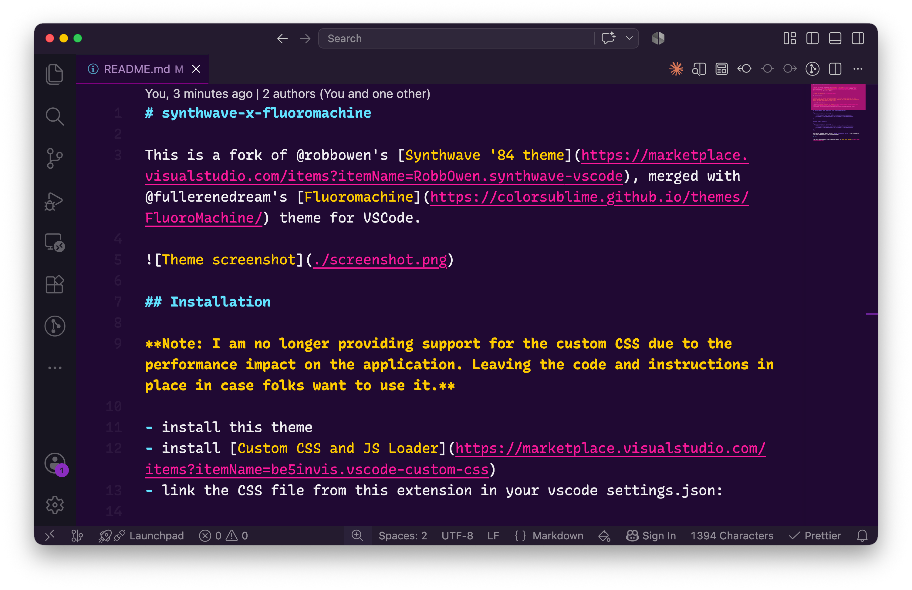

# synthwave-x-fluoromachine

This is a fork of @robbowen's [Synthwave '84 theme](https://marketplace.visualstudio.com/items?itemName=RobbOwen.synthwave-vscode), merged with @fullerenedream's [Fluoromachine](https://colorsublime.github.io/themes/FluoroMachine/) theme for VSCode.



## Installation

**Note: I am no longer providing support for the custom CSS due to the performance impact on the application. Leaving the code and instructions in place in case folks want to use it.**

- install this theme
- install [Custom CSS and JS Loader](https://marketplace.visualstudio.com/items?itemName=be5invis.vscode-custom-css)
- link the CSS file from this extension in your vscode settings.json:

```
On Mac it might look something like the snippet below:

{
  "vscode_custom_css.imports": [
    "file:///Users/{your username}/.vscode/extensions/webrender.synthwave-x-fluoromachine-0.0.15/synthwave-x-fluoromachine.css"
    ]
}

Windows might resemble:

{
  "vscode_custom_css.imports": [
    "file:///C:/Users/{your username}/.vscode/extensions/webrender.synthwave-x-fluoromachine-0.0.15/synthwave-x-fluoromachine.css"
    ]
}
```

• From the command panel, select `Reload Custom CSS and JS`. You'll need to run this command every time vscode updates.

## Font

The font being used in the screenshot above is [Rec Mono Casual](https://www.recursive.design/).
